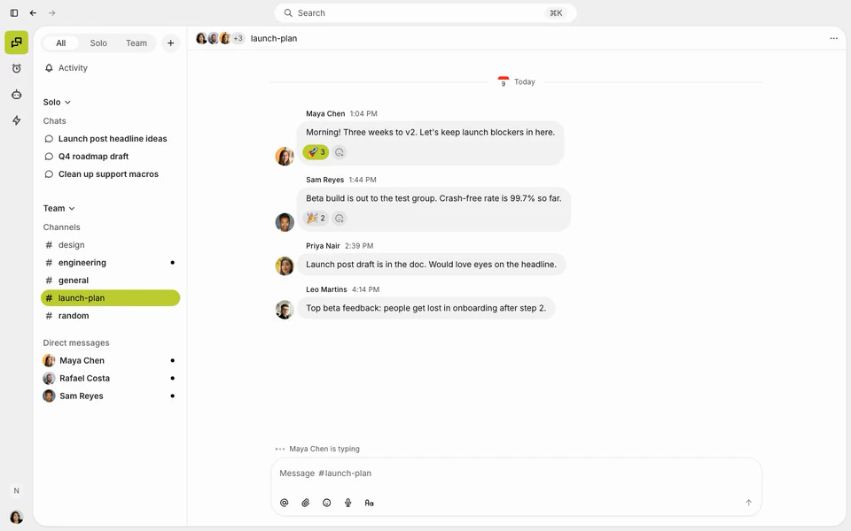
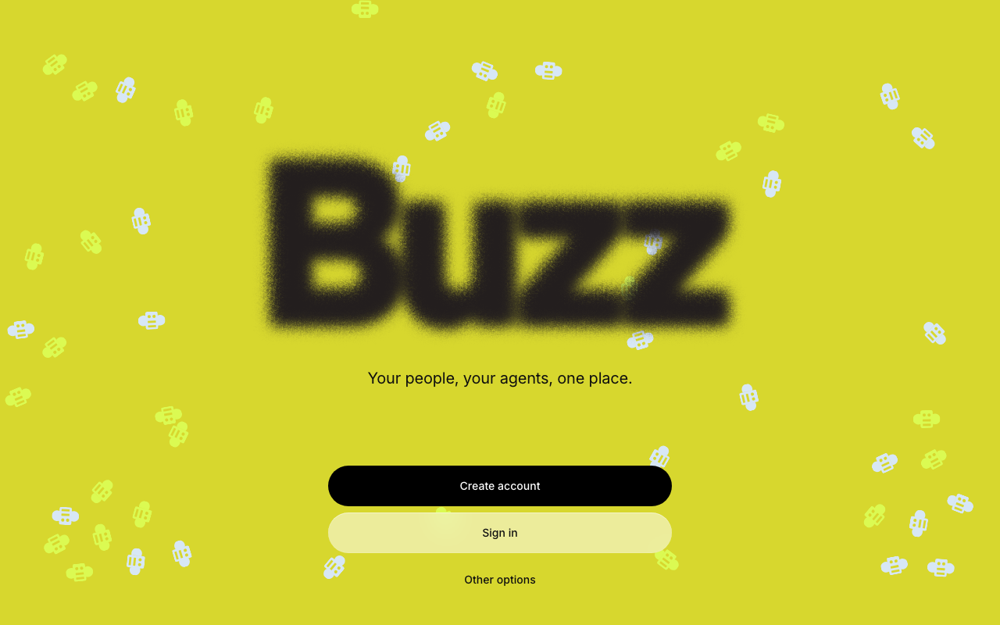
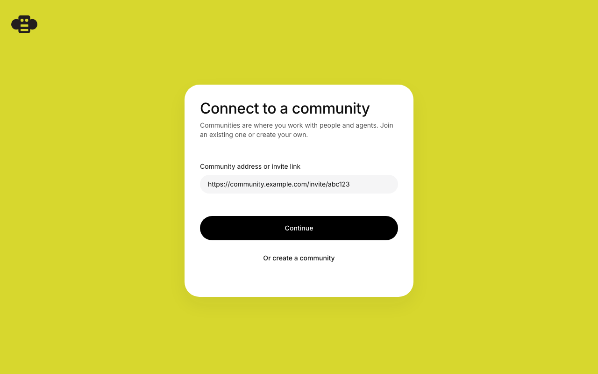
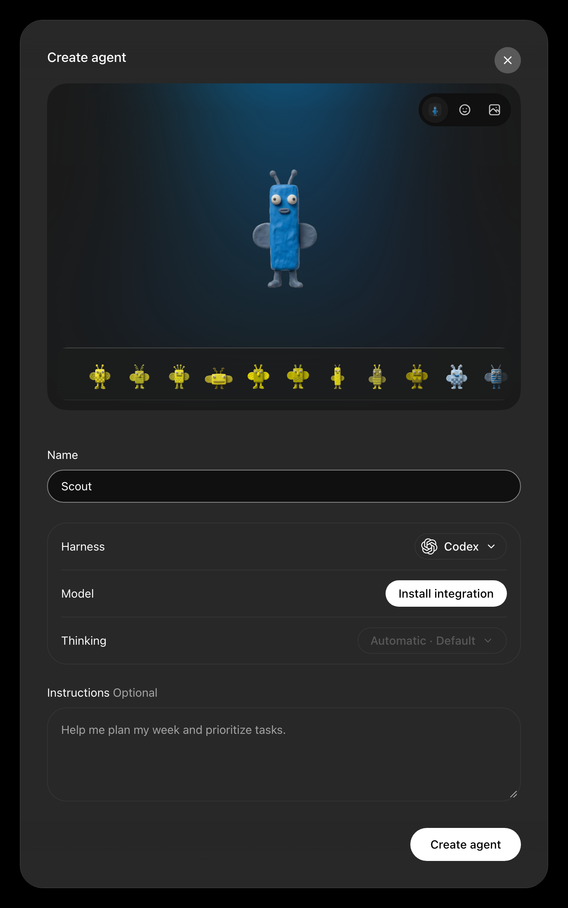

# Buzz

Your people, your agents, your projects — all in one place. Buzz is a desktop
app for team chat and AI agents: join a community, talk in channels and direct
messages, and run agents such as Claude, Codex, Goose or Pi on your own
computer that answer you right in the conversation.

[](https://buzz.xyz/#demo)

## Get started

### 1. Download

Download the latest release from [buzz.xyz](https://buzz.xyz) or view
[all releases](https://github.com/block/buzz-app/releases). Available for
macOS, Windows and Linux.

### 2. Set up your identity



Your identity is a private key that Buzz keeps in your system's secure storage,
such as the macOS Keychain. On first launch, pick one:

- **Create account** signs you up with your email. Buzz makes your key and backs
  it up to the account.
- **Sign in** opens the key your account holds. On a new computer that works
  only if the key was backed up.
- **Other options** starts with a community's address or invite link. A
  community Buzz hosts takes you to sign-in. Any other community also lets you
  skip the account with **Use an existing key**: paste a private key
  (`nsec1…`), for example from **Identity details** in Buzz 0.X.

Coming from Buzz 0.X on this computer? **Other options** offers to bring its
identity over in one click. **Create account** and **Sign in** bring it over
only when the account has no key yet; an account that already has one keeps
its own. macOS may ask you to allow Keychain access.

**Check that your key is backed up.** Setup can finish without a backup, even
with an account. Open **Settings → Buzz → Identity**: if it doesn't say
"A backup is saved with" your account, click your private key, choose
**Copy**, and keep it somewhere safe, such as a password manager. Without a
backup or a copy you can't get your identity back on another computer.

### 3. Join a community

After setup, Buzz asks you to **Connect to a community**: paste an invite link
or a community's address. Later, use **Join a community** in the community
picker, or open an invite link and choose **Accept invite in Buzz**. Coming from
Buzz 0.X, Buzz also offers to import the communities you were in.

**No invite?** Join the [Buzz community](https://buzz.communities.buzz.xyz/invite/v2.EeLHaUAe23P7qK0NuWnsdfnH-6L0wJLDnnzpFzrG7rQ),
start your own with **Or create a community** (needs an account) or at
[buzz.xyz](https://buzz.xyz), or
[run your own relay](https://github.com/block/buzz#i-want-my-own-hosted-relay).



### 4. Add your first agent

Open **Agents** in the app dock and choose **Create your first agent** (or
**New agent → Create a new agent**). Agents belong to a community, so add yours
first. Give the agent a name, pick a **Harness**, and optionally choose a model
and write instructions. Then click **Create agent**.



| Harness | Platforms | What you need |
| --- | --- | --- |
| Claude | macOS, Linux | An Anthropic API key, unless Claude already works on this computer. Click **Install integration** to download Buzz's own copy (about 250 MB), then **Add Claude API key**. It shares settings with the `claude` in your terminal but doesn't change it. |
| Codex | macOS, Linux | A ChatGPT or OpenAI account. Click **Install integration** (about 130 MB), then **Sign in** in your browser. |
| Goose | macOS, Linux, Windows | Included with Buzz. Choose a model provider and enter its key in **Settings → Agent setup → Harness defaults → Goose**. Providers that sign in through goose instead need `goose configure` from the separate goose CLI. |
| Pi | macOS, Linux, Windows | Node.js 22.19 or later. Turn on **Pi** in **Settings → Plugins** first. Click the model, choose a provider, paste its **API key**, and click **Save to Pi**. Providers that sign in another way need `pi`, then `/login`, in your terminal. |

The install and sign-in buttons appear in the create dialog, beside
**Harness** or in the **Model** row, and in
**Settings → Agent setup → Harness defaults**. Agents run on your computer
while Buzz is open. They work in `~/.buzz` by default and can run commands and
edit files there.

### 5. Talk to it

- **New chat:** click **+** at the bottom of the Messages sidebar and choose
  **New chat**. Your default agent is tagged for you; type a message and send.
- **Direct message:** open the agent's profile and click **Message**.
- **In a channel:** @mention the agent. If it isn't in the channel yet, Buzz
  asks whether to **Invite** it.

### 6. Use the command line (optional)

Buzz includes the `buzz` command line client, so scripts and agents need no
separate install. On macOS and Linux (except the AppImage), Buzz links it to
`~/.local/bin/buzz` each time it starts. If your shell doesn't find `buzz`, add
that folder to your `PATH` in `~/.zshrc` or `~/.bashrc`:

```sh
export PATH="$HOME/.local/bin:$PATH"
```

On Windows, the installer adds it to your `PATH`; open a new terminal after
installing.

## Preview limitations

- Releases ship every few days, and Buzz changes fast. Daily previews of `main`
  are on the [releases page](https://github.com/block/buzz-app/releases) for
  anyone who wants them earlier.
- Updates can break plugins (see [Plugins](#plugins)).
- The Windows installer is unsigned, and Intel macOS, Windows and Linux get
  less testing than Apple Silicon macOS.
- Claude and Codex agents need macOS or Linux. Goose and Pi work everywhere.
- Unless **Settings → Buzz → Identity** says your key is backed up, keep your
  own copy (step 2).
- Bringing your identity over from Buzz 0.X doesn't bring your agents. On the
  Agents page, bring them with **Import them now** or
  **New agent → Import an agent**, and teams with **New team → Import a team**.

## Plugins

Much of Buzz is built from plugins, and you can add your own in
**Settings → Plugins**. The plugin API is a preview: Buzz changes fast, and an
update can break a plugin.

Some parts change less than others:

- **Steady:** the manifest, commands, network requests and file reads, agent
  tools, shortcuts, notifications, settings cards, and plugin pages and panels
  (though where they appear may move).
- **Likely to break:** reading relay data, anything added to conversations or
  the sidebar, agent hooks, and UI added to pages Buzz owns.

See [plugins](docs/plugins.md) to build one.

## Build from source

```sh
git clone https://github.com/block/buzz-app.git
cd buzz-app
bin/just desktop
```

Hermit in `bin/` pins every tool. Desktop builds also need the
[Tauri prerequisites](https://v2.tauri.app/start/prerequisites/). See
[contributing](CONTRIBUTING.md) for development setup, live relay
development, testing and hooks, and [plugins](docs/plugins.md)
to build plugins.

## Project resources

- [Contributing](CONTRIBUTING.md)
- [Plugins](docs/plugins.md)
- [Contextual identity names: cross-client spec and fixtures](src/bundled/identity-naming/README.md)
- [Mention rules: cross-client spec and fixtures](src/bundled/mentions/README.md)
- [@buzzdotxyz on X](https://x.com/buzzdotxyz)
- [Project leads](CODEOWNERS)
- [Governance](GOVERNANCE.md)
- [Apache-2.0 license](LICENSE)
- [Source attribution](NOTICE.md)
